<h1 align="center">
  
</h1>

 

  Hi, I'm audixdev.
   
   
  🔬 I'm currently studying for a ICT Software Developer degree.
   
  🌐 I've been focusing a lot on API-related projects, either helping others with them or coding them myself.
    
  📚 I’m currently building: 
  - 🔧 <a href="https://github.com/openomen">OpenOMEN</a> - Unofficial driver and daemon for HP OMEN hardware on Ubuntu Linux. 
  - 🤖 <a href="https://github.com/audixdev/beacon">Beacon</a> - Free, self-hosted SEO + GEO audit dashboard. 
  - 🔧 And more behind the scenes... 

   
  💬 Ask me anything <a href="https://github.com/audixdev/audixdev/issues" title="Issues">here</a>
   
  📫 How to reach me: <a href="mailto: audixdev@gmail.com">audixdev@gmail.com</a> & <a href="https://discord.com/users/1114205353991745618">Discord (audixdev)</a>

<h2 align="center">🔥 Languages & Frameworks & Tools & Abilities 🔥</h2>
 

  <code>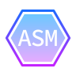</code>
  <code></code>
  <code>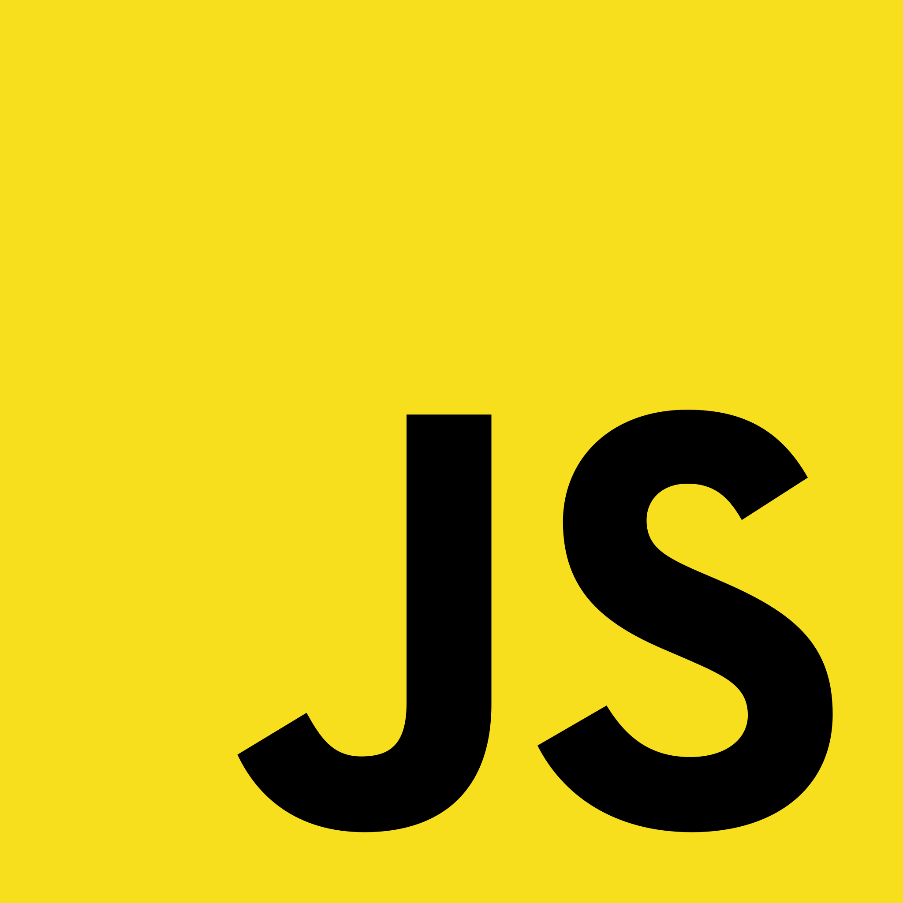</code>
  <code>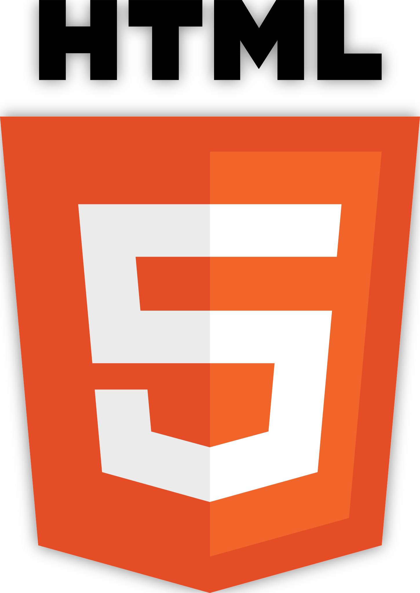</code>
  <code>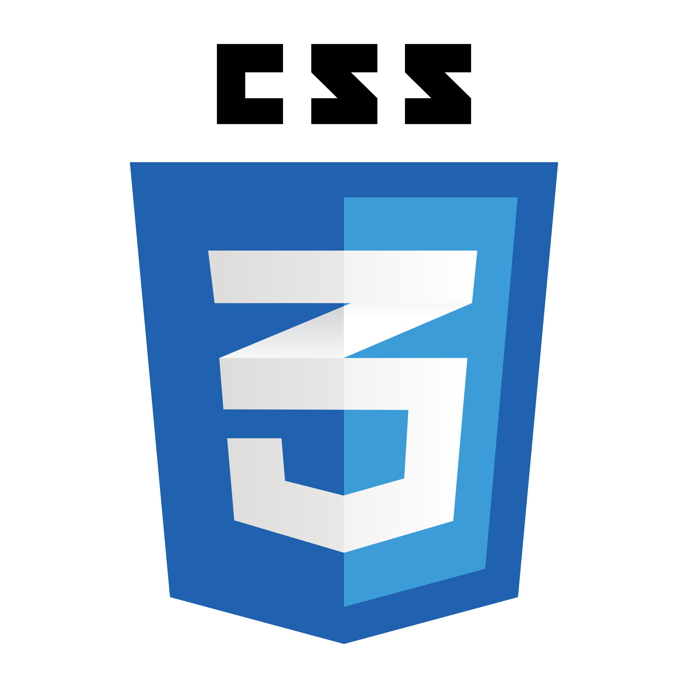</code>
  <code></code>
  <code>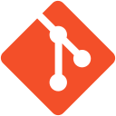</code>
  <code>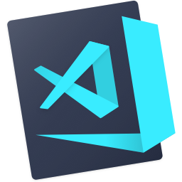</code>
  <code>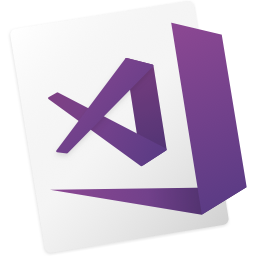</code>
  <code></code>
  <code></code>
  <code></code>
  <code></code>
  <code></code>
  <code>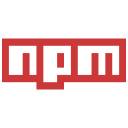</code>
  <code></code>
  <code></code>
  <code>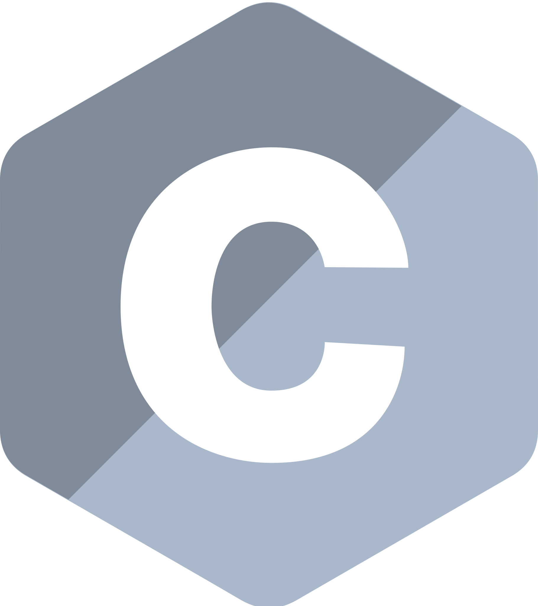</code>
  <code>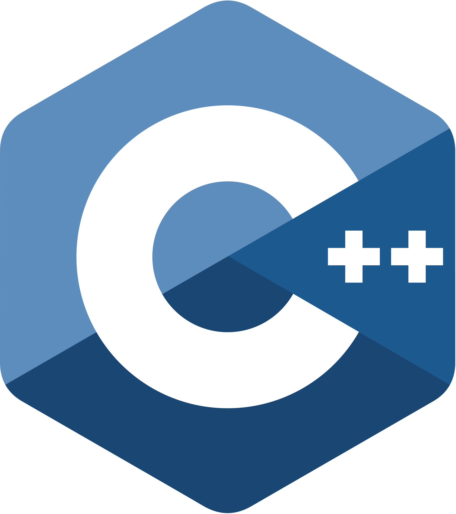</code>
  <code>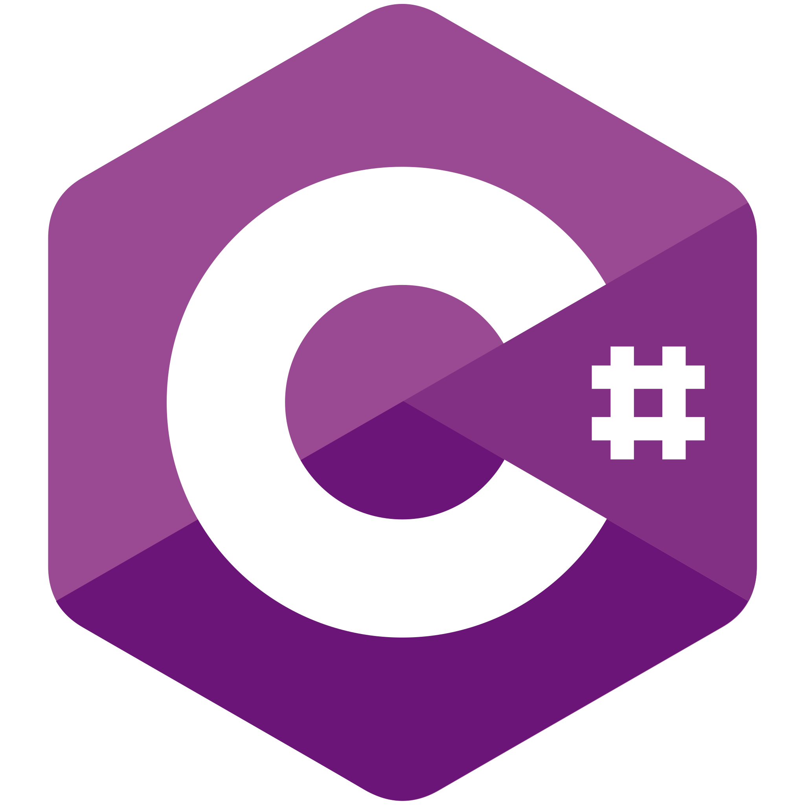</code>

<h2 align="center">⚡ Stats ⚡</h2>
 

  

    
  

   

  

<h2 align="center">👨‍💻 Credits 👨‍💻</h2>
 

  
<h4 align="center">
  README.md Credits
  <a href="https://github.com/zumrudu-anka/zumrudu-anka" title="Show Repositories">🔎 made by Zumrudu-Anka 🔍</a>
</h4>

<!--
**audixdev/audixdev** is a ✨ _special_ ✨ repository because its `README.md` (this file) appears on your GitHub profile.

Here are some ideas to get you started:

- 🔭 I’m currently working on ...
- 🌱 I’m currently learning ...
- 👯 I’m looking to collaborate on ...
- 🤔 I’m looking for help with ...
- 💬 Ask me about ...
- 📫 How to reach me: ...
- 😄 Pronouns: ...
- ⚡ Fun fact: ...

Notes: If you want use this readme, firstly star it please. If you can't align your repositories like this, please change your repository desription to shorter than now. Maybe 4 or 5 word will be good.

-->
